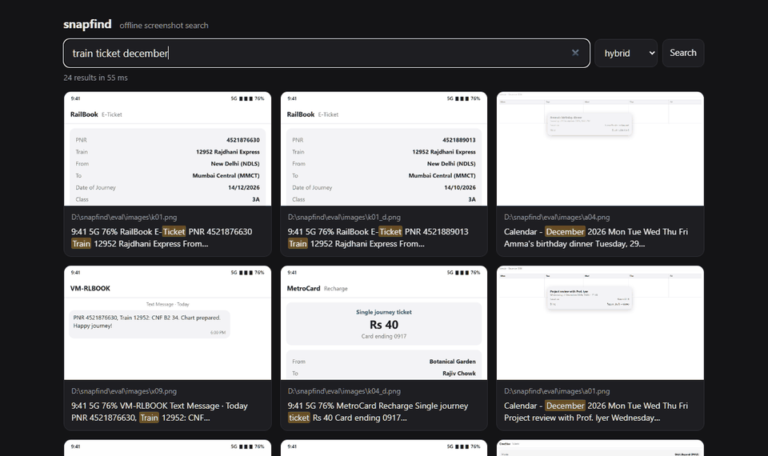

# snapfind

**Search your screenshots by the text in them. Runs 100% on your own machine. Works with Wi-Fi off.**

```
> snapfind "train ticket december"
 1. eval\images\k01.png
    9:41 5G 76% RailBook E-[Ticket] PNR 4521876630 [Train] 12952 Rajdhani Express From…
 2. eval\images\k01_d.png
    9:41 5G 76% RailBook E-[Ticket] PNR 4521889013 [Train] 12952 Rajdhani Express From…
 3. eval\images\a04.png
    Calendar - [December] 2026 Mon Tue Wed Thu Fri Amma's birthday dinner Tuesday, 29…
```

The December ticket (`14/12/2026`) ranks above its October twin (`14/10/2026`): "december" matches the numeric date.



<sub>Real output from real searches over the synthetic eval set (`eval/demo.py`, captured with headless Edge). None of my own screenshots are in this repo.</sub>

## Why

You took a screenshot of the ticket, the Wi-Fi password, or that error message. Weeks later you can't find it among 2,000 files called `Screenshot (1437).png`.
snapfind reads the text in every screenshot (OCR), keeps it in a small local database, and lets you search by the words you remember *or* by what you meant.

## Works with Wi-Fi off

snapfind makes **no network calls**. The OCR models come inside the `rapidocr` wheel and the MiniLM embedding model comes inside snapfind itself, so nothing is downloaded at runtime, there is no telemetry, and there are no accounts.

This is tested, not just promised:
- [`tests/test_offline.py`](tests/test_offline.py) starts a fresh Python process, makes every socket call raise *before* anything is imported, then indexes real images with OCR and searches them.
- In CI the same test also runs inside a Linux network namespace with no interfaces (`unshare --net`), which also catches native code (onnxruntime, OpenCV) that would bypass Python's socket module.

## Install

```bash
uv tool install git+https://github.com/NAMAN-VERMA-02/snapfind
```

(or `pipx install git+https://github.com/NAMAN-VERMA-02/snapfind`). Python 3.10+. That one step is the whole setup; the first `index` needs no download.

## Use

```bash
snapfind index                      # OCR your Screenshots folder (newest first, resumable)
snapfind index D:\phone-export      # add another folder, e.g. an Android export; it is remembered
snapfind "wifi password"            # search (shorthand for: snapfind search ...)
snapfind "port already in use" --mode keyword -n 5
snapfind serve                      # local web UI at http://127.0.0.1:8765
snapfind watch                      # keep indexing new screenshots as you take them
snapfind forget D:\phone-export\private   # drop from the index and skip from now on
```

On Windows, snapfind finds the *real* Screenshots folder from the registry. On OneDrive machines that is often `OneDrive\Pictures\Screenshots 1`, not `Pictures\Screenshots`.
Every search first indexes up to 20 new screenshots, so `watch` is optional.

## How it works

```
screenshot ─► RapidOCR (PP-OCRv6, ONNX) ─► text ─┬─► SQLite FTS5 (BM25, porter stemming)
                                                 └─► MiniLM-L6 int8 vectors (64-word chunks)

query ─┬─► BM25 top 50 (stopwords dropped) ─┐
       └─► cosine top 50 ───────────────────┴─► Reciprocal Rank Fusion (k = 60)
                                                 ─► results, merged by content hash
```

- **Dates:** a month in the query matches numeric dates in the text (`14/12/2026` → december) and the capture date from the file name or mtime.
- **Cache:** a file whose path, mtime and size haven't changed is never read again. A moved, renamed or copied screenshot is recognised by its sha1 and reuses its text and vectors with no OCR.
- **Tall scroll captures** are cut into overlapping slices before OCR, so their text isn't shrunk into unreadable pixels.

## Results (real runs)

**Eval set** ([`eval/`](eval)): 100 synthetic screenshots (chats, tickets, UPI payments, receipts, terminal errors, code, settings, emails, notes and more; fictional brands only). Each one has a *hard-negative twin*, the same kind of screen with a few fields changed (another month, a bus instead of a train, another amount), so the index holds 200 images. 19 targets are deliberately hard to OCR: JPEG artifacts, blur, low contrast, a small font, or a tall scroll capture.
**Queries** ([`eval/cases.jsonl`](eval/cases.jsonl)): one per target. 50 are *exact* (words that appear in the image) and 50 are *paraphrase* (the meaning in other words, e.g. "is my train seat confirmed" for an SMS saying `CNF B2 34. Chart prepared`). I wrote all of them and committed them before the first run.

**Top-3 hit rate**: is the right screenshot among the first 3 results? From [`eval/results.json`](eval/results.json), with 95% Wilson intervals for "all":

| queries | keyword (BM25) | semantic (MiniLM) | **hybrid** (default) |
|---|---|---|---|
| all 100 | 75 (66–83) | **95** (89–98) | 89 (81–94) |
| exact 50 | 48 | 49 | 49 |
| paraphrase 50 | 27 | **46** | 40 |
| OCR-hard images 19 | 12 | 18 | 14 |

**Top-1**: is the right screenshot first?

| queries | keyword | semantic | hybrid |
|---|---|---|---|
| exact 50 | 47 | 41 | **47** |
| paraphrase 50 | 14 | **34** | 19 |

What that means:
- Meaning beats keywords on paraphrases (46 vs 27 of 50). Hybrid fixes 14 of keyword's misses and breaks none.
- **Semantic alone scored highest overall on this set** (95 vs 89 for hybrid). Hybrid stays the default because it puts the exact screenshot *first* more often when you remember its words (47 vs 41 of 50). Semantic search tends to rank the near-identical twin first. For vague queries, use `--mode semantic`.
- The eval caught a ranking bug: common words like "when", "my" and "the" flooded the keyword list ([#6](https://github.com/NAMAN-VERMA-02/snapfind/issues/6)). Fixing it ([#7](https://github.com/NAMAN-VERMA-02/snapfind/pull/7)) moved hybrid from 87 to 89 and keyword from 71 to 75. The fix was designed *after* seeing that run, so the current numbers are not held-out; the first run is in [`eval/results_before_fix.json`](eval/results_before_fix.json).

**Speed**

| | GitHub runner, clean ([run](https://github.com/NAMAN-VERMA-02/snapfind/actions/runs/42704931891), [`results_ci.json`](eval/results_ci.json)) | my laptop, busy |
|---|---|---|
| CPU | AMD EPYC 7763, 4 vCPU, Linux | Intel i3-1215U, 8 threads, Windows 11 |
| first index (OCR + vectors), 200 images | **0.84 images/s** (239 s) | 0.15 images/s (1,337 s) |
| re-index when nothing changed (cache) | **2.5 ms** for 200 files | 10 ms |
| search, median (warm) | **1.5 ms** | 2.6 ms |
| models loaded | 0.8 s | 6.3 s |

The laptop run happened while several other heavy jobs had the CPU pinned and the disk nearly full, so its speed column is pessimistic. Both runs gave *identical* accuracy.

**My real Screenshots folder** (2,013 PNGs, mostly 1080p desktop captures; only aggregate numbers are published, never their text):
- First index: 9.7 hours, **0.058 images/s**, on the i3 laptop, overnight while other jobs also ran. Real desktop screenshots hold far more text than the eval screens, so expect a slow first run on a laptop. It goes newest first, so recent screenshots are searchable in seconds, and it can resume after Ctrl+C.
- After that: running `snapfind index` with nothing new takes **about 1.5 s end to end** for all 2,013 files (Python startup, folder scan, database check), with 0 OCR runs.

**Scale test** ([`eval/results_scale.json`](eval/results_scale.json)): the same 100 queries with those 2,013 real screenshots added as distractors, 2,213 images in all (11× more). Top-3: **keyword 68, semantic 82, hybrid 79**. Exact queries: keyword 46, semantic 47, hybrid **49** of 50. Paraphrase queries: keyword 22, semantic 35, hybrid 30 of 50. Search median: 7.9 ms. This is pessimistic: a real screenshot that genuinely matches a query (I have real train tickets too) counts as a miss.

**Caveats.** The screenshots are rendered by a browser, so they're cleaner than real ones (no wallpapers, photos or overlapping windows). I wrote both the screens and the queries. 100 queries gives wide intervals, as shown above. Treat these as a sanity check, not a benchmark.

**Reproduce:** `python eval/run.py` (about 200 OCR runs), or Actions → **Eval** → *Run workflow*.

**Where it still fails** (hybrid, not in the top 3): "when is the practical file due" (the screen says *lab record submission*; no mode finds it) and "study schedule for coding interviews" (a note titled *DSA revision plan*), plus paraphrases where semantic search finds the screenshot but keyword noise pushes it down, like "login for the shared streaming account". Every row is in `results.json`.

## Privacy

The index (`%LOCALAPPDATA%\snapfind\index.db`) holds the text of your screenshots in plain SQLite. That's the same exposure as the screenshots themselves, but easier to search, so treat it like them.
`snapfind forget PATH`, `--exclude GLOB` and `snapfind reset` remove things. The web UI listens only on 127.0.0.1, rejects other `Host` headers (which blocks DNS rebinding), and serves images only by their index id, never by path.

## Limitations

- English (and Chinese) text. Hindi in Devanagari script isn't recognised yet; Hinglish typed in Roman script is.
- No HEIC. You need Python (no .exe yet).
- Vectors are searched by brute force: fine up to about 100k screenshots.

## License

MIT. Bundled model: [all-MiniLM-L6-v2](https://huggingface.co/sentence-transformers/all-MiniLM-L6-v2) (Apache-2.0), see [snapfind/model/NOTICE.md](snapfind/model/NOTICE.md). OCR models: PaddleOCR via RapidOCR (Apache-2.0).
